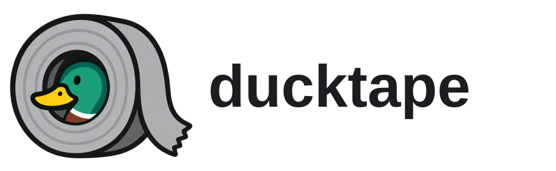

<p align="center">
  <picture>
    <source media="(prefers-color-scheme: dark)" srcset="assets/lockup-dark.svg">
    
  </picture>
</p>

Brand assets for the ducktape software projects. The mark shows a mallard peeking through a roll of duct tape. It preserves the selected roll and torn tape composition, with the duck colored after the male mallard reference.

## Use the assets

| Need | File |
| --- | --- |
| Master transparent artwork | [`source/mark.png`](source/mark.png) |
| Icon in SVG container | [`assets/mark.svg`](assets/mark.svg) |
| Square favicon | [`assets/favicon.svg`](assets/favicon.svg) |
| Standalone lockup | [`assets/lockup-light.svg`](assets/lockup-light.svg), [`assets/lockup-dark.svg`](assets/lockup-dark.svg) |
| Project lockups | [`assets/product/`](assets/product/) |
| PNG icon exports, 32–1024 px | [`exports/png/`](exports/png/) |

Use the light lockup on light backgrounds and the dark lockup on dark backgrounds. Keep the mark's proportions and leave clear space around the torn tape end. The product repositories contain copies of the files used in their READMEs.

## Source and regeneration

[`source/mark.png`](source/mark.png) is the high resolution transparent master. The SVGs embed that image; they are **not fully vector artwork**. The lockup lettering is outlined vector text, using Liberation Sans Bold from [`source/fonts/`](source/fonts/). The selected sketch and earlier refinement are preserved in [`concepts/`](concepts/) for reference.

```sh
uv sync --locked
uv run --locked python scripts/build.py
```

The build writes the SVGs under `assets/` and PNG sizes under `exports/png/`. Commit the source image and generated files together.

## Color direction

The duck uses a green head, yellow bill, white neck ring, and brown chest, following the supplied mallard photo. The tape stays neutral gray so the duck remains the focal point.
